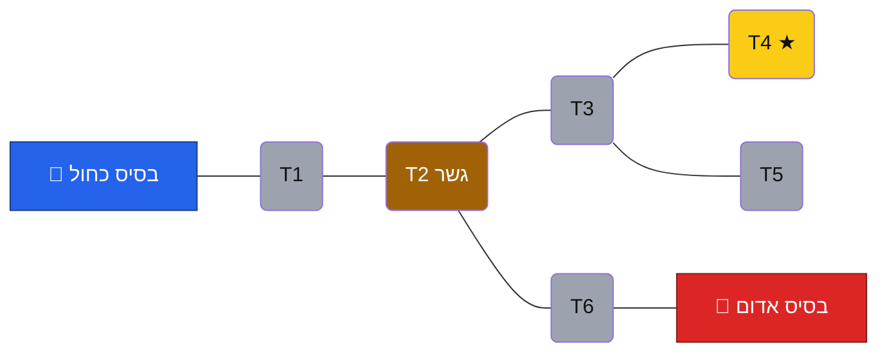
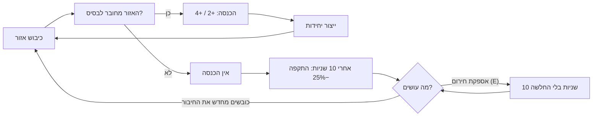
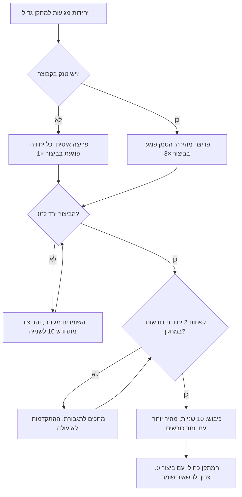
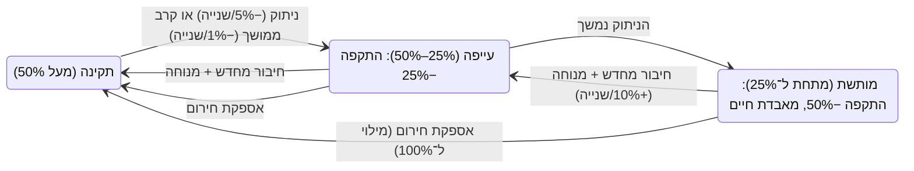
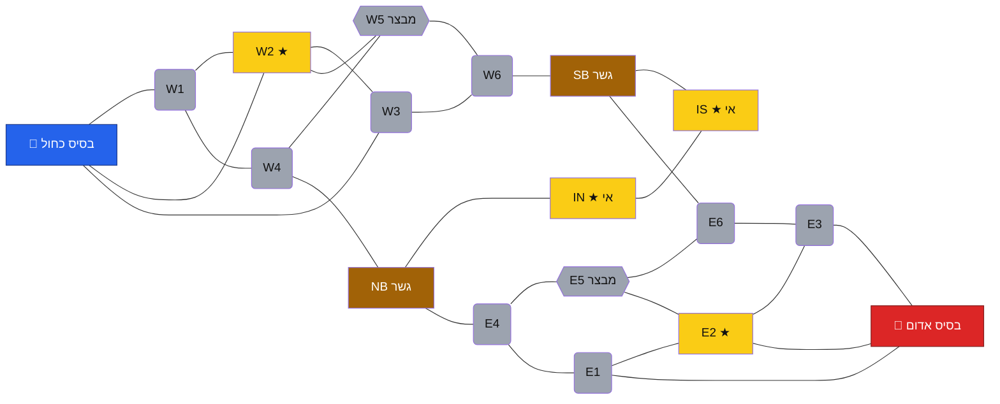
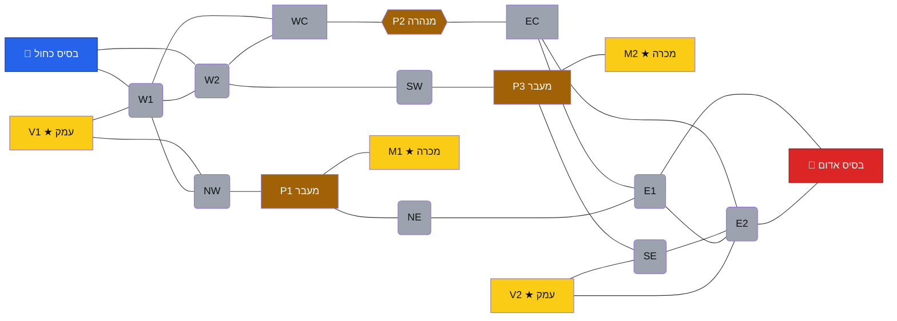
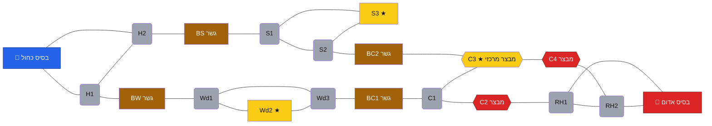

# תכנון רמות – כיבוש המפה | MAP CONQUEST

**חברי הצוות:** אביתר אהרון, כפיר נזרי

---

## מבנה הרמות

במשחק יש **רמת מדריך** ו**שלוש רמות קושי**. רמת הקושי קובעת את **החוקים** ואת **התנהגות היריב**, ולא את המפה. בכל רמת קושי אפשר לשחק בכל אחת מהמפות (ראו [קטלוג המפות](#קטלוג-המפות)). חלק מהמפות קשות יותר מאחרות בגלל המבנה שלהן.

| | מדריך | קלה | בינונית | קשה |
|---|---|---|---|---|
| **מהות** | לימוד המשחק | המשחק הרגיל | מתקנים מבוצרים | מבוצרים + אספקה ועייפות |
| **חוקים** | חוקי הבסיס, אחד אחד | חוקי הבסיס במלואם | קלה + גודל מתקנים, ביצורים ושמירה | בינונית + מד אספקה ליחידות, אספקת חירום תכופה |
| **היריב** | מתוסרט | רגיל | שומר ומתקיף בכוח מרוכז | תוקפני ומתוחכם, עם יתרון פתיחה |
| **זמן קרב** | ללא הגבלה | 8 דקות | 8 דקות | 7 דקות |
| **מפה** | מפת אימון קבועה | כל המפות | כל המפות | כל המפות |

**איך לומדים חוקים חדשים:** המדריך מלמד רק את חוקי הבסיס. החוקים של הרמה הבינונית והקשה מוצגים בפעם הראשונה שמשחקים ברמה: מסך פתיחה קצר עם 2–3 משפטים, ואחריו הודעה צפה בפעם הראשונה שהשחקן פוגש כל חוק.

### ההתאמה לסקר השוק

| ממצא מסקר השוק | ההחלטה בתכנון |
|---|---|
| ל־67% מהשחקנים חשוב פחות תכנון מורכב מאשר ב־2015 | המדריך מלמד **חוק אחד בכל שלב**. הרמה הקלה היא המשחק הבסיסי, בלי חוקים נוספים |
| קהל משני: שחקני io (גילאי 16–25) שרוצים כיבוש מהיר ונגיש | הרמה הקלה מתאימה להם: כלל אספקה אחד, 3 יחידות, קרב של עד 8 דקות |
| קהל עיקרי: שחקני RTS ותיקים (גילאי 25–40) | הבינונית והקשה מוסיפות עומק (ביצורים, עייפות) בלי להאריך את הקרב. הקשה מוגבלת ל־7 דקות |
| מוטיבציית "שליטה וכוח" ותכנון | ברמה הבינונית ניתוק דורש מתקפה מתוכננת, וברמה הקשה האספקה היא משאב שצריך לנהל כל הזמן |
| שחקן יחיד, ניצחון בכישרון ולא במזל | ליריב יש **סדר עדיפויות קבוע** בכל רמה. אין בונוסים נסתרים: היתרון שלו ברמה הקשה מוצג במסך הפתיחה |

### מוסכמות

- **קואורדינטות:** כל משבצת ברשת היא 4×4 יחידות ב־Unity. ‏(0,0) היא הפינה השמאלית העליונה, ו־y גדל כלפי מטה.
- **בסיסים** לא נספרים באחוז השליטה, ואי אפשר לכבוש אותם.
- **הכנסה:** אזור רגיל +2 משאבים לכל 5 שניות, ★ נקודת משאבים +4.
- **בתרשימי המפות:** כחול = שחקן, אדום = יריב, אפור = ניטרלי, צהוב = ★ משאבים, חום = גשר או מעבר. **צורת האזור** מראה את גודל המתקן, שמשנה רק ברמה הבינונית והקשה: עגול = מוצב קטן, מלבן = מתקן בינוני, משושה = מתקן גדול.

---

## רמה 0 – מדריך: "מחנה האימונים"

**מטרה:** ללמד את חוקי הבסיס בכ־4 דקות, בלי אפשרות להפסיד. זו המשחקון שמופיע בכניסה הראשונה למשחק, ואפשר לחזור אליו מהתפריט.

### תרשים

נהר זורם מצפון לדרום בעמודה 2. הגשר T2 הוא המעבר היחיד מהבסיס הכחול לצד המזרחי. 6 אזורים, ולכן 5 נדרשים לניצחון.

| אזור | קואורדינטות | סוג | שכנים |
|---|---|---|---|
| בסיס כחול | (0,1) | בסיס | T1 |
| T1 | (1,1) | רגיל | בסיס, T2 |
| T2 | (2,1) | גשר | T1, T3, T6 |
| T3 | (3,1) | רגיל | T2, T4, T5 |
| T4 | (4,1) | ★ משאבים | T3 |
| T5 | (3,2) | רגיל | T3 |
| T6 | (3,0) | רגיל | T2, בסיס אדום |
| בסיס אדום | (4,0) | בסיס | T6 |

### שלבי המדריך

כל שלב נפתח רק אחרי שהקודם הושלם. ההודעה מופיעה בחלון קטן בראש המסך, וחץ מהבהב מצביע על היעד.

| # | הטריגר להתחלה | ההודעה לשחקן | מה השחקן עושה | מה לומדים |
|---|---|---|---|---|
| 1 | תחילת הרמה | "לחץ על חייל, ואז לחץ ימני על האזור המסומן" | שולח חי"ר ל־T1. אחרי 4 שניות האזור נצבע בכחול ומופיע "+2" | בחירה, תנועה וכיבוש |
| 2 | T1 נכבש | "אזורים מחוברים מכניסים משאבים. ייצר חייל נוסף" | כפתור החי"ר מודגש. השחקן מייצר חייל (60 ← 40) | ייצור יחידות |
| 3 | נוצר חייל | "כבוש את הגשר ואת נקודת המשאבים" | כובש את T2, אחר כך את T3 ואז את T4 ★. קו כחול מוצג מהבסיס עד T4 | קווי אספקה, ★ שווה +4 |
| 4 | T4 נכבש | "האויב מתקרב לגשר!" (המשחק מואט פי 2 לשלוש שניות) | רכב סיור אדום יוצא מהבסיס האדום דרך T6 וכובש את T2 תוך 6 שניות. המדריך דואג שלא יהיה חייל כחול על T2 באותו רגע | **ניתוק:** T3 ו־T4 נהיים דהויים עם סמל אזהרה, וההכנסה יורדת |
| 5 | עברו 10 שניות של ניתוק | "היחידות המנותקות נחלשות! בחר את T4 ולחץ E" | מפעיל אספקת חירום על T4: מטוס מצניח ארגז אספקה על האזור. אם יש פחות מ־25 משאבים, המדריך נותן את ההפרש | אספקת חירום והמחיר שלה |
| 6 | הופעלה אספקת חירום | "טנק חזק בקרב, אבל לא יכול לכבוש לבד" | כפתור הטנק נפתח, והשחקן מקבל 50 משאבים. מייצר טנק וחייל, הטנק משמיד את רכב הסיור והחייל כובש מחדש את T2 | תפקיד הטנק, ושיקום החיבור |
| 7 | T2 נכבש מחדש | "כבוש 5 אזורים והחזק בהם 20 שניות" | כובש את T5 (ואם רוצה גם את T6). פס הניצחון מתמלא | תנאי הניצחון בשליטה |

**כללים מיוחדים במדריך:**
- אין שעון קרב, והבסיס האדום לא מייצר יחידות. רכב הסיור משלב 4 הוא היחידה האדומה היחידה.
- אם לשחקן לא נשארה אף יחידה, נוצר חייל חי"ר חינמי בבסיס.
- כפתורי הטנק ואספקת החירום נעולים עד השלב שבו לומדים אותם.

**למה זה מתאים לרמת מדריך:** חוק אחד בכל שלב, מסלול אחד ברור, ואי אפשר להפסיד. גם שחקני io שלא שיחקו RTS יכולים לסיים אותו.

---

## רמה 1 – קלה: המשחק הרגיל

**מטרה:** הקרב כפי שתוכנן במסמך [הרכיבים הרשמיים](formal-elements.%20map-conquest.md), בלי שינויים. גודל המתקנים לא משנה ברמה הזו: כל אזור נכבש באותה דרך.

### החוקים

| נושא | הערך |
|---|---|
| **פתיחה** | 60 משאבים, 2 חי"ר ורכב סיור, לכל צד |
| **כיבוש** | יחידה אחת שנשארת באזור בלי יריב: 4 שניות לחי"ר, 6 לרכב סיור. טנק לא כובש |
| **הכנסה** | הבסיס 5 לכל 5 שניות, אזור מחובר 2, ★ מחובר 4 |
| **ניתוק** | אזור מנותק לא מכניס. אחרי 10 שניות של ניתוק, ההתקפה של היחידות בו יורדת ב־25% |
| **אספקת חירום** | פעמיים בקרב, 25 משאבים, 10 שניות. מטוס מצניח ארגז על האזור, והחלשת היחידות מוסרת |
| **יחידות** | חי"ר 20, רכב סיור 30, טנק 50. עד 12 יחידות לכל צד |
| **ניצחון** | 70% מהאזורים למשך 20 שניות, או השמדת בסיס היריב (500 נקודות חיים). אחרי 8 דקות: מי שמחזיק ביותר אזורים |

### התנהגות היריב

היריב בודק את סדר העדיפויות כל 3 שניות, ומבצע את הפעולה הראשונה שמתאימה:

1. **הגנה:** אם יחידה כחולה נמצאת באזור צמוד לבסיס האדום, כל היחידות חוזרות להגן.
2. **התרחבות:** כיבוש האזור הניטרלי הקרוב שצמוד לשטח אדום. ★ קודם לאזור רגיל.
3. **ניתוק מזדמן:** מדקה 2:00, פעם בדקה לכל היותר: אם יש אזור כחול שנפילתו תנתק לפחות 2 אזורים, ואין עליו שומר, נשלח אליו רכב סיור.
4. **מתקפה:** פעם ב־45 שניות, אם ליריב יש לפחות אותו מספר יחידות כמו לשחקן, כל היחידות מלבד אחת תוקפות את האזור הכחול הקרוב ביותר.

- **סדר ייצור קבוע:** חי"ר, חי"ר, רכב סיור, חי"ר, טנק, וחוזר חלילה.
- **אספקת חירום:** פעם אחת בקרב, כשאזור ★ אדום מנותק.

### תרשים: לולאת המשחק ברמה הקלה

**למה זה מתאים לרמה קלה:** אלה החוקים שהשחקן כבר למד במדריך, בלי שום תוספת. היריב מתרחב ותוקף, אבל מנתק רק מדי פעם ורק עם רכב סיור אחד, כך שיש זמן להגיב.

---

## רמה 2 – בינונית: מתקנים מבוצרים

**מטרה:** קשה יותר לכבוש ולנתק, וצריך גם להשקיע יותר בשמירה. כל החוקים של הרמה הקלה נשארים, ונוספים החוקים הבאים.

**מסך הפתיחה:** "ברמה הזו המתקנים מבוצרים. מתקנים בינוניים דורשים 2 יחידות כדי לכבוש, ומתקנים גדולים דורשים טנק שיפרוץ את הביצורים. שמור עליהם, או שהאויב יכבוש אותם מהר."

### גודל מתקנים

לכל אזור במפה יש גודל, שמסומן בתרשים ובמשחק בסמל:

| סוג | סמל | דוגמאות | מה צריך לכבוש | זמן כיבוש | שומרים מומלצים |
|---|---|---|---|---|---|
| **מוצב קטן** | 🚩 דגל | רוב האזורים הרגילים | יחידה כובשת אחת | 4 שניות (רכב סיור: 6) | 1 |
| **מתקן בינוני** | 🏭 מבנה | ★ משאבים, רוב הגשרים | לפחות 2 יחידות כובשות בו־זמנית | 8 שניות | 2 |
| **מתקן גדול** | 🏰 חומות | מבצרים, מנהרות, צמתים מרכזיים | קודם לפרוץ את הביצור, ואז לפחות 2 יחידות כובשות | 10 שניות אחרי הפריצה | 3 |

### חוקים חדשים

1. **ביצור:** למתקן גדול יש פס ביצור של 200 נקודות. כל עוד הפס לא ריק, אי אפשר להתחיל לכבוש אותו. כל היחידות יכולות לתקוף את הביצור, אבל **טנק פוגע בו פי 3**.
2. **יותר כובשים, כיבוש מהיר יותר:** כל יחידה כובשת מעבר למינימום מקצרת את הזמן ב־25%, עד 2 יחידות נוספות. למשל, מתקן בינוני עם 4 כובשים נכבש ב־4 שניות במקום 8.
3. **שמירה:** אם יש באזור פחות שומרים מהמומלץ, היריב כובש אותו **פי 2 מהר יותר**.
4. **ביצור מתחדש:** מתקן גדול שבשליטתך משקם את הביצור ב־10 נקודות בשנייה, אבל רק כשיש עליו לפחות שומר אחד. מתקן גדול שנכבש עכשיו מתחיל עם ביצור 0, ולכן הוא פגיע בשניות הראשונות.
5. **התקדמות כיבוש נמחקת:** אם הכובשים עוזבים או מובסים באמצע, ההתקדמות יורדת חזרה באותו קצב שבו עלתה.
6. **ניתוק דורש מתקפה מתוכננת:** בכל המפות, רוב נקודות הניתוק (גשרים, מעברים ומנהרות) הן מתקנים בינוניים או גדולים. רכב סיור לבד כבר לא מספיק כדי לנתק.

### התנהגות היריב

כל מה שיש ברמה הקלה, עם השינויים הבאים:

1. **שמירה:** היריב מציב את מספר השומרים המומלץ על כל נקודת ניתוק שלו, לפני שהוא שולח יחידות להתרחבות.
2. **ניתוק בכוח מרוכז:** מדקה 1:30 (ולא 2:00), במקום רכב סיור בודד הוא שולח קבוצה בגודל הנדרש: 2 יחידות למתקן בינוני, וטנק ועוד 2 חי"ר למתקן גדול.
3. **ניצול חולשה:** אם מתקן כחול שמור בפחות מהמומלץ, הוא עולה לראש סדר העדיפויות של המתקפה.
4. **שיקום:** אחרי שכבש מתקן גדול, היריב משאיר עליו לפחות שומר אחד עד שהביצור מתמלא.

### תרשים: כיבוש מתקן גדול

**למה זה מתאים לרמה בינונית:** החוקים של הרמה הקלה נשארים, וכל אחד מהחוקים החדשים הוא הרחבה של מה שהשחקן כבר מכיר. ההחלטות נהיות כבדות יותר: כל שומר שמשאירים מאחור הוא יחידה פחות להתקפה, וכל ניתוק דורש לתכנן הרכב כוח. זה העומק שמחפשים שחקני ה־RTS הוותיקים, בלי להוסיף יחידות.

---

## רמה 3 – קשה: אספקה ועייפות

**מטרה:** כל מה שיש בבינונית, ובנוסף האספקה הופכת למשאב שצריך לנהל כל הזמן, והיריב חזק ומתוחכם יותר.

**מסך הפתיחה:** "ברמה הזו לחיילים יש מד אספקה. הם מתעייפים בקרב, ובאזור מנותק האספקה שלהם נגמרת מהר. האויב מתחיל עם יתרון: 2 אזורים כבושים ויחידה נוספת."

### מד אספקה

ברמה הזו, **ההחלשה הקבועה של 25% מוחלפת במד אספקה** (0–100%) שמוצג מעל כל יחידה:

| מצב היחידה | שינוי במד |
|---|---|
| באזור מחובר, במנוחה | עולה ב־10% בשנייה |
| באזור מחובר, בתנועה או בקרב (**עייפות**) | יורד ב־1% בשנייה |
| באזור מנותק | יורד ב־5% בשנייה, בכל מצב |

| ערך המד | ההשפעה על היחידה |
|---|---|
| מעל 50% | תקינה |
| 25%–50% | התקפה −25%, תנועה −20% |
| מתחת ל־25% | התקפה −50%, תנועה −20%, ומאבדת 1 נקודת חיים בשנייה |

**במספרים:** יחידה מלאה שמתנתקת מגיעה ל־50% אחרי 10 שניות (כמו ההחלשה ברמה הקלה), ול־25% אחרי 15 שניות. יחידה שנלחמת בחזית שתי דקות ברצף תגיע לכמעט 0 גם בלי ניתוק, ולכן צריך לסובב יחידות ולתת להן לנוח באזור מחובר.

### אספקת חירום תכופה

| | קלה ובינונית | קשה |
|---|---|---|
| **משך** | 10 שניות | 5 שניות |
| **מחיר** | 25 משאבים | 35 משאבים |
| **שימושים בקרב** | 2 | 4 |
| **השפעה** | מבטלת את ההחלשה | ממלאת את מד האספקה של היחידות באזור ל־100%, ועוצרת את הירידה למשך 5 שניות |

**איך זה נראה:** בכל הרמות אספקת החירום מגיעה כארגז שמוצנח ממטוס. ברמה הקשה, אם האזור המנותק צמוד לאזור מחובר, האספקה מגיעה במשאית שנוסעת ממנו. גם המשאית וגם המטוס הם אנימציה בלבד ולא יחידה שמשחקים בה.

### התנהגות היריב

**יתרון פתיחה (מוצג במסך הפתיחה):** היריב מתחיל עם 2 חי"ר, רכב סיור וטנק, ו־2 האזורים הקרובים לבסיס שלו כבר כבושים. לשחקן יש 40 משאבים במקום 60.

כל 2 שניות, הפעולה הראשונה שמתאימה:

1. **פשיטה מוקדמת:** בשנייה 50, קבוצה בגודל הנדרש יוצאת לנקודת הניתוק הכחולה שהכי פחות שמורה.
2. **הגנה חלקית:** אם הבסיס האדום מותקף, חוזרות רק היחידות שנמצאות במרחק של עד 2 אזורים. השאר ממשיכות במשימה.
3. **נסיגה ומנוחה:** יחידה עם פחות מ־30% נקודות חיים או פחות מ־30% אספקה חוזרת לאזור מחובר כדי להתמלא.
4. **לחץ בשתי חזיתות:** כל מתקפה מתחלקת לשתי קבוצות, שתוקפות בו־זמנית את שתי נקודות הניתוק שמחזיקות הכי הרבה אזורים כחולים.
5. **בלימה:** כשלשחקן יש 60% מהאזורים או יותר, כל היחידות האדומות תוקפות את נקודת הניתוק הכחולה החשובה ביותר.
6. **התרחבות:** כיבוש ★ קודם, אחר כך האזור הניטרלי הקרוב.

- **סדר ייצור:** חי"ר, רכב סיור, טנק, חי"ר, וחוזר חלילה.
- **מטרות בקרב:** תוקף קודם יחידות חי"ר כחולות, כי הן אלה שכובשות.
- **אספקת חירום:** משתמש בכל 4 השימושים, כשיחידות שלו באזור מנותק יורדות מתחת ל־50%.

### תרשים: מד האספקה של יחידה

**למה זה מתאים לרמה קשה:** השחקן צריך לנהל שלושה דברים במקביל: שטח, ביצורים ואספקה. גם יחידות באזור מחובר מתעייפות, כך שאי אפשר להשאיר צבא בחזית לאורך זמן. היריב מתחיל עם יתרון ותוקף בשתי חזיתות. מצד שני, הוא פועל לפי סדר קבוע שאפשר ללמוד, והיתרון שלו מוצג בגלוי. שחקן שמצפה לפשיטה בשנייה 50 ומסובב יחידות בזמן יכול לנצח בכישרון.

---

## קטלוג המפות

כל מפה זמינה בכל רמות הקושי. דירוג הקושי של המפה (★–★★★) נקבע לפי המבנה שלה, בנפרד מרמת הקושי שבחרת. גודל המתקן של כל אזור (קטן / בינוני / גדול) משנה רק ברמה הבינונית והקשה.

| מפה | אזורים | נדרש לניצחון (70%) | קושי המפה | מה מייחד אותה |
|---|---|---|---|---|
| **עמק הנהר** | 16 | 12 | ★ | סימטרית, אי עם שני חיבורים, הרבה מסלולים |
| **רכס ההרים** | 17 | 12 | ★★ | 3 מעברים בלבד, מכרות שאפשר להגיע אליהם רק ממעבר אחד |
| **דלתת הנהר** | 18 | 13 | ★★★ | לא סימטרית: כל הצד הכחול תלוי בגשרים, והיריב מחובר ביבשה |

### מפה 1: עמק הנהר ★

נהר רחב זורם בעמודה 3. אפשר לחצות אותו בשני גשרים, דרך אי שמחולק לשני אזורים. בכל צד יש מבצר מרכזי (W5, E5) שמחבר בין האזורים של אותו צד.

| אזור | קואורדינטות | סוג | מתקן | שכנים |
|---|---|---|---|---|
| בסיס כחול | (0,2) | בסיס | – | W1, W2, W3 |
| W1 | (1,1) | רגיל | קטן | בסיס, W2, W4 |
| W2 | (1,2) | ★ משאבים | בינוני | בסיס, W1, W3, W5 |
| W3 | (1,3) | רגיל | קטן | בסיס, W2, W6 |
| W4 | (2,0) | רגיל | קטן | W1, W5, NB |
| W5 | (2,2) | מבצר | גדול | W2, W4, W6 |
| W6 | (2,4) | רגיל | קטן | W3, W5, SB |
| NB | (3,0) | גשר | בינוני | W4, IN, E4 |
| IN | (3,1) | ★ משאבים | בינוני | NB, IS |
| IS | (3,3) | ★ משאבים | בינוני | SB, IN |
| SB | (3,4) | גשר | בינוני | W6, IS, E6 |
| E4 | (4,0) | רגיל | קטן | NB, E5, E1 |
| E5 | (4,2) | מבצר | גדול | E2, E4, E6 |
| E6 | (4,4) | רגיל | קטן | SB, E5, E3 |
| E1 | (5,1) | רגיל | קטן | E4, E2, בסיס אדום |
| E2 | (5,2) | ★ משאבים | בינוני | E1, E3, E5, בסיס אדום |
| E3 | (5,3) | רגיל | קטן | E6, E2, בסיס אדום |
| בסיס אדום | (6,2) | בסיס | – | E1, E2, E3 |

**הדילמות במפה:** הצד של כל שחקן כולל 6 אזורים, והאי והגשרים עוד 4. כדי להגיע ל־12 חייבים להחזיק לפחות 2 אזורים בצד של היריב. האי מחובר דרך שני גשרים, ולכן אובדן של גשר אחד לא מנתק אותו, אלא אם השחקן מחזיק רק גשר אחד.

### מפה 2: רכס ההרים ★★

רכס הרים חוסם את עמודה 3. אפשר לעבור רק במעבר הצפוני (P1), במנהרה המרכזית (P2) ובמעבר הדרומי (P3). בתוך הרכס יש שני מכרות (M1, M2), ואל כל אחד מגיעים **רק דרך מעבר אחד**. בכל צד יש עמק ★ צדדי (V1, V2).

| אזור | קואורדינטות | סוג | מתקן | שכנים |
|---|---|---|---|---|
| בסיס כחול | (0,2) | בסיס | – | W1, W2 |
| V1 | (0,0) | ★ משאבים | בינוני | W1, NW |
| W1 | (1,1) | רגיל | קטן | בסיס, V1, W2, NW, WC |
| W2 | (1,3) | רגיל | קטן | בסיס, W1, SW, WC |
| NW | (2,0) | רגיל | קטן | V1, W1, P1 |
| WC | (2,2) | רגיל | בינוני | W1, W2, P2 |
| SW | (2,4) | רגיל | קטן | W2, P3 |
| P1 | (3,0) | מעבר | בינוני | NW, M1, NE |
| M1 | (3,1) | ★ משאבים | בינוני | P1 |
| P2 | (3,2) | מנהרה | גדול | WC, EC |
| M2 | (3,3) | ★ משאבים | בינוני | P3 |
| P3 | (3,4) | מעבר | בינוני | SW, M2, SE |
| NE | (4,0) | רגיל | קטן | P1, E1 |
| EC | (4,2) | רגיל | בינוני | P2, E1, E2 |
| SE | (4,4) | רגיל | קטן | P3, E2, V2 |
| E1 | (5,1) | רגיל | קטן | EC, NE, E2, בסיס אדום |
| E2 | (5,3) | רגיל | קטן | EC, SE, E1, V2, בסיס אדום |
| V2 | (6,4) | ★ משאבים | בינוני | E2, SE |
| בסיס אדום | (6,2) | בסיס | – | E1, E2 |

**הדילמות במפה:**
- **המכרות מפתים:** M1 מכניס פי 2, אבל אם P1 נופל, M1 מתנתק, ואיתו NE אם השחקן מחזיק בו. האם להשאיר שומרים על P1, או להשתמש בהם להתרחבות?
- **המנהרה היא מפתח:** P2 הוא המסלול הקצר לצד השני. ברמה הבינונית והקשה הוא מתקן גדול, ולכן צריך טנק כדי לפרוץ אותו.
- **גם ליריב יש נקודות ניתוק:** אם השחקן כובש את P1 בזמן שהיריב מחזיק ב־M1, המכרה האדום מתנתק.

### מפה 3: דלתת הנהר ★★★

הבסיס הכחול נמצא בפינה הדרומית־מערבית, והבסיס האדום בפינה הצפונית־מזרחית. נהרות מחלקים את הצד הכחול לאיים: **כל אזור כחול מחוץ לבית תלוי בגשר**, בעוד שהיריב מחובר למרכז ביבשה. במפה הזו היריב מתחיל עם C2 ו־C4 כבושים, בכל רמת קושי.

| אזור | קואורדינטות | סוג | מתקן | שכנים | בפתיחה |
|---|---|---|---|---|---|
| בסיס כחול | (0,6) | בסיס | – | H1, H2 | כחול |
| H1 | (1,5) | רגיל | קטן | בסיס, H2, BW | ניטרלי |
| H2 | (2,6) | רגיל | קטן | בסיס, H1, BS | ניטרלי |
| BW | (1,4) | גשר | בינוני | H1, Wd1 | ניטרלי |
| Wd1 | (1,3) | רגיל | קטן | BW, Wd2, Wd3 | ניטרלי |
| Wd2 | (0,2) | ★ משאבים | בינוני | Wd1, Wd3 | ניטרלי |
| Wd3 | (2,2) | רגיל | קטן | Wd1, Wd2, BC1 | ניטרלי |
| BS | (3,6) | גשר | בינוני | H2, S1 | ניטרלי |
| S1 | (4,6) | רגיל | קטן | BS, S2, S3 | ניטרלי |
| S2 | (5,5) | רגיל | קטן | S1, S3, BC2 | ניטרלי |
| S3 | (6,6) | ★ משאבים | בינוני | S1, S2 | ניטרלי |
| BC1 | (3,2) | גשר | בינוני | Wd3, C1 | ניטרלי |
| BC2 | (5,4) | גשר | בינוני | S2, C3 | ניטרלי |
| C1 | (4,2) | רגיל | קטן | BC1, C2, C3 | ניטרלי |
| C2 | (5,1) | מבצר | גדול | C1, RH1 | **אדום** |
| C3 | (5,3) | ★ מבצר מרכזי | גדול | BC2, C1, C4 | ניטרלי |
| C4 | (6,3) | מבצר | גדול | C3, RH2 | **אדום** |
| RH1 | (6,0) | רגיל | קטן | C2, RH2, בסיס אדום | ניטרלי |
| RH2 | (8,2) | רגיל | קטן | C4, RH1, בסיס אדום | ניטרלי |
| בסיס אדום | (8,0) | בסיס | – | RH1, RH2 | אדום |

*ברמה הקשה היריב מקבל בנוסף את 2 האזורים הקרובים לבסיס שלו (RH1, RH2), כך שהוא מתחיל עם 4 אזורים.*

**הדילמות במפה:**
- **הבית קטן:** יש לשחקן רק 2 אזורים בטוחים, וכל השאר מעבר לגשר.
- **אי אפשר לנצח רק בצד שלך:** הצד הכחול כולל 12 אזורים (הבית, שני האיים וארבעת הגשרים). כדי להגיע ל־13 חייבים להחזיק אזור במרכז, מול היריב.
- **ניתוק אחד גדול:** אובדן BW מנתק בבת אחת 4 אזורים (Wd1–Wd3 ו־BC1).
- **הדרך לנצח היא לנתק:** אם השחקן כובש את C2 או את C4, הוא מנתק את האזורים האדומים שמאחוריהם במרכז.

---

## הערות לאיזון

- כל המספרים (נקודות חיים, זמני היריב, קצב מד האספקה, ביצור) הם ערכים ראשוניים. נבדוק אותם עם 5–10 שחקנים, כמו שהומלץ בסקר השוק.
- **מדד הצלחה למדריך:** לפחות 90% מהבודקים מסיימים אותו בלי עזרה.
- **מדד הצלחה לרמה הקשה:** שחקן שמנצח ברמה הבינונית צריך לנצח בקשה במפה "עמק הנהר" תוך 3–5 ניסיונות. אם זה לוקח יותר, נאט את ירידת מד האספקה או נדחה את הפשיטה המוקדמת.

